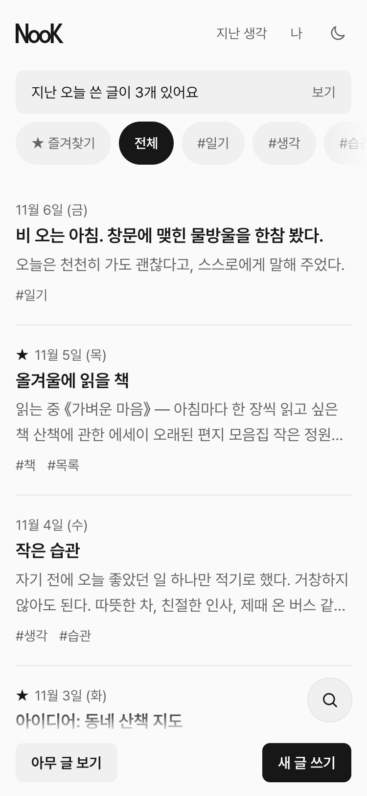
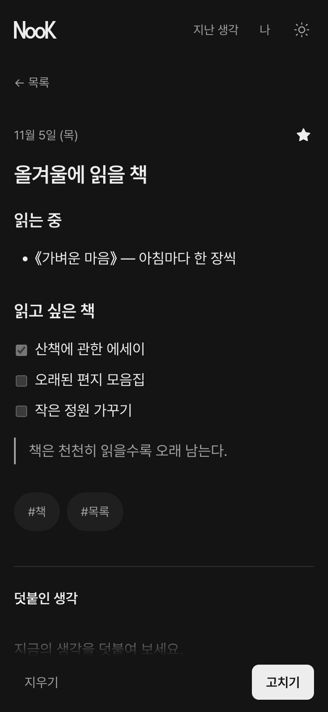
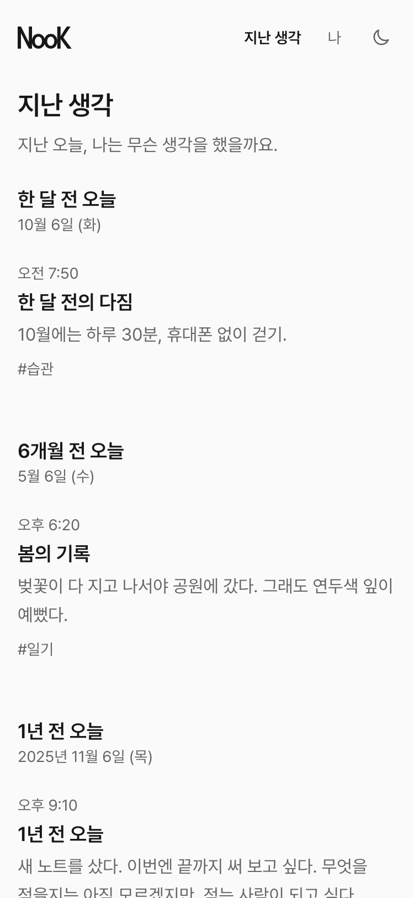
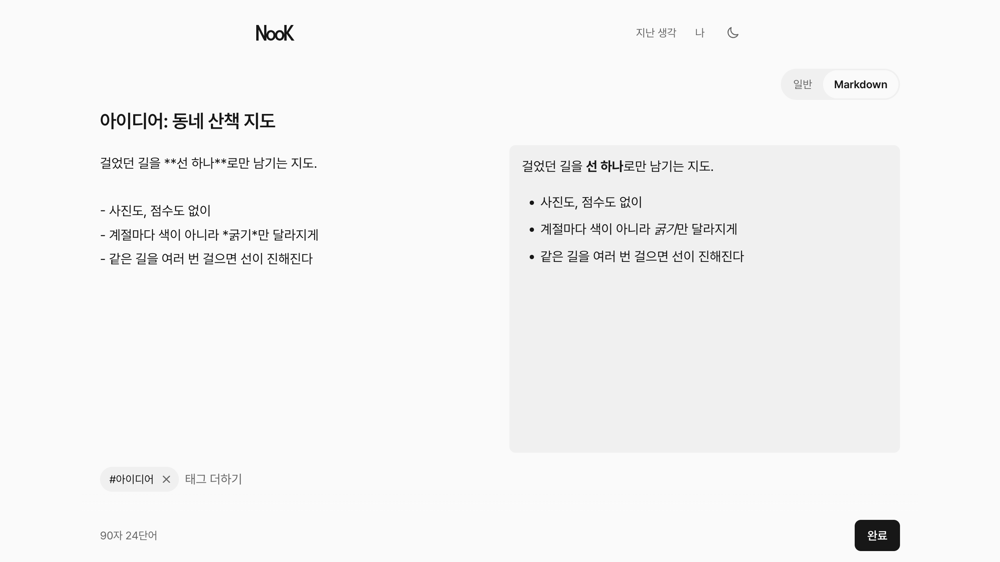
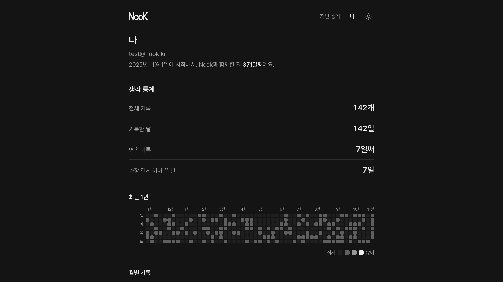

<div align="center">


<br><br>

<picture>
  <source media="(prefers-color-scheme: dark)" srcset="docs/readme/logo-dark.svg">
  
</picture>

<p>나만의 작은 구석.<br>일기, 아이디어, 메모를 조용히 기록하고 다시 꺼내 보는 공간.</p>

<p><a href="https://nook-three-opal.vercel.app"><b>Nook 열기</b></a> &nbsp;|&nbsp; <a href="https://github.com/choitjddn0311/nook/releases/latest">최신 버전</a></p>

<br>

&nbsp;
&nbsp;


</div>

## 이런 앱이에요

장식 없이 글이 주인공인 개인 기록장입니다. 흑·백·회색만 쓰고, 쓰는 동안에는 방해하지 않습니다.

**쓰기**
- 제목 없이 본문만 써도 됩니다
- 쓰는 동안 자동으로 저장되고, 연결이 끊겨도 기기에 임시로 보관했다가 다시 연결되면 저장합니다
- 글마다 일반 글 또는 Markdown을 고를 수 있고, PC에서는 미리보기를 나란히 봅니다
- 태그, 글자 수·단어 수

**다시 꺼내 보기**
- 제목·본문 검색, 태그로 거르기, ★ 즐겨찾기
- **지난 생각**: 한 달 전, 6개월 전, 1년 전 같은 날에 쓴 기록
- **아무 글 보기**: 지난 글을 무작위로 한 편씩
- 지난 글 아래에 지금의 생각을 날짜와 함께 덧붙이기 (원래 글은 그대로)

**나**
- 전체 기록, 기록한 날, 연속 기록
- 1년 활동 달력, 월별 기록, 자주 쓴 태그

<p align="center">
  
  
</p>

## 설치하기

Nook은 웹앱(PWA)입니다. 앱 스토어 없이 홈 화면에 설치하면 일반 앱처럼 열립니다.

| 기기 | 방법 |
|---|---|
| iPhone · iPad | **Safari**로 열기 → 공유 버튼 → **홈 화면에 추가** |
| Android | **Chrome**으로 열기 → 오른쪽 위 ⋮ → **앱 설치** (또는 홈 화면에 추가) |
| Windows · Mac (Chrome, Edge) | 주소창 오른쪽의 **설치** 아이콘 → 설치 |
| Mac (Safari) | 메뉴 막대의 **파일 → Dock에 추가** |

> 지금은 개인용으로 운영 중이라 **회원가입이 열려 있지 않습니다.** 초대받은 계정만 로그인할 수 있습니다.

## 화면

- 폰, 태블릿, PC 어디서든 같은 기록을 이어서 씁니다
- **낮/밤 테마**: 처음엔 기기 설정을 따르고, 오른쪽 위 버튼으로 직접 바꾸면 기억합니다
- 키보드만으로 모든 기능을 쓸 수 있고, 글자 대비는 WCAG AA 기준을 지킵니다

## 개인정보와 보안

- 모든 기록은 **본인만 읽고 쓸 수 있습니다.** 데이터베이스 행 단위 보안(RLS)으로 다른 계정의 글에 접근할 수 없습니다
- Markdown 글 안의 HTML은 실행하지 않고, 위험한 링크는 막습니다
- 앱에 비밀 키를 두지 않습니다. 브라우저에 공개되어도 되는 키만 쓰고, 권한은 데이터베이스 정책이 지킵니다

## 직접 실행하기

개발하거나 자신의 Nook을 따로 띄우고 싶은 경우입니다.

**준비물**: Node.js 20.9 이상, [Supabase](https://supabase.com) 프로젝트

```bash
git clone https://github.com/choitjddn0311/nook.git
cd nook
npm install
```

프로젝트 루트에 `.env.local` 파일을 만들고 Supabase 프로젝트 값(Project Settings → API)을 넣습니다.

```bash
NEXT_PUBLIC_SUPABASE_URL=https://<프로젝트 ref>.supabase.co
NEXT_PUBLIC_SUPABASE_PUBLISHABLE_KEY=<publishable 키>
```

데이터베이스는 `supabase/migrations/`의 SQL을 **파일 이름 순서대로** 적용합니다 (Supabase SQL Editor 또는 `supabase db push`). 테이블과 RLS 정책이 함께 만들어집니다.

로그인할 계정은 Supabase 대시보드 **Authentication → Users → Add user**에서 만듭니다. 앱에는 가입 화면이 없습니다.

```bash
npm run dev     # http://localhost:3000
npm run build   # 배포용 빌드 확인
```

**배포**: Vercel에 저장소를 연결하고 위 환경 변수 두 개를 넣으면 됩니다. 서버 지역은 Supabase 지역과 가깝게 맞추세요 (`vercel.json`의 `regions`).

## 만든 재료

| | |
|---|---|
| 프레임워크 | Next.js 16 (App Router), React, TypeScript |
| 스타일 | Tailwind CSS v4, Pretendard |
| 데이터·로그인 | Supabase (PostgreSQL, Auth, RLS) |
| Markdown | react-markdown, remark-gfm, remark-breaks |
| 배포 | Vercel |

## 버전 기록

바뀐 내용은 [Releases](https://github.com/choitjddn0311/nook/releases)에 있습니다.

## 라이선스

[MIT](LICENSE)
