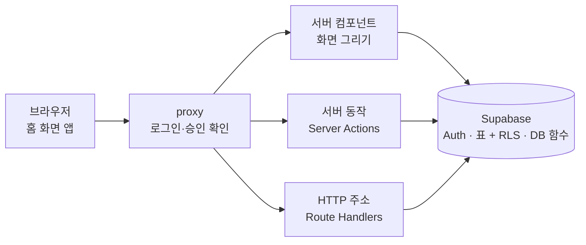
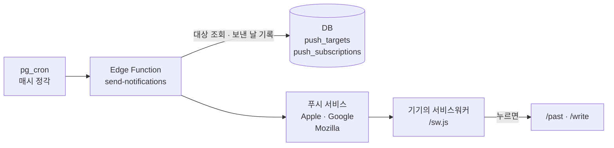

# Nook API 명세서

Nook에는 다른 앱이 가져다 쓰는 공개 REST API가 없습니다. 대신 화면과 데이터 사이에 네 개의 층이 있고, 이 문서는 각 층의 **입력, 출력, 권한, 오류**를 정리합니다.

| 층 | 수 | 누가 부르나 | 코드 |
|---|---|---|---|
| [HTTP 주소](#3-http-주소) | 3 | 브라우저 | `src/app/**/route.ts` |
| [서버 동작](#4-서버-동작-server-actions) | 22 | Nook 화면 | `src/app/**/actions.ts` |
| [데이터베이스](#5-데이터베이스) | 표 7, 함수 17 | 서버 동작, 발송 함수 | `supabase/migrations/` |
| [Edge Function](#6-edge-function) · [예약 작업](#7-예약-작업) | 1 · 2 | DB 예약 작업 | `supabase/functions/` |

> 기준: `main` 브랜치, 2026-11-08. 코드를 바꾸면 같은 PR에서 이 문서도 고칩니다([9번](#9-문서-유지-규칙)).

## 목차
1. [구조](#1-구조)
2. [권한 모델](#2-권한-모델)
3. [HTTP 주소](#3-http-주소)
4. [서버 동작 (Server Actions)](#4-서버-동작-server-actions)
5. [데이터베이스](#5-데이터베이스)
6. [Edge Function](#6-edge-function)
7. [예약 작업](#7-예약-작업)
8. [오류 코드](#8-오류-코드)
9. [문서 유지 규칙](#9-문서-유지-규칙)

---

## 1. 구조

**요청 흐름**: 화면에서 데이터까지



**알림 흐름**: 사용자가 고른 시각에 지난 오늘·글쓰기 알림



Next.js는 Vercel(dub1), Supabase는 eu-west-1(아일랜드)에 있습니다.

- 브라우저는 Supabase를 **직접 부르지 않습니다.** 모든 읽기와 쓰기는 Next.js 서버(서버 컴포넌트, 서버 동작, HTTP 주소)를 거칩니다.
- 서버는 **공개 키(publishable key)와 사용자 로그인 쿠키**로 Supabase를 부릅니다. 앱에는 비밀 키(service role)가 없습니다.
- 그래서 권한은 화면이 아니라 **데이터베이스가 지킵니다**(RLS와 security definer 함수). 공개 키만 가진 사람이 API를 직접 불러도 같은 규칙이 적용됩니다.

## 2. 권한 모델

### 역할

| 역할 | 어떻게 정해지나 | 할 수 있는 것 |
|---|---|---|
| 비로그인 (`anon`) | 로그인 쿠키 없음 | 랜딩·문서 보기, 가입, 로그인, 비밀번호 복구, 문의 보내기 |
| 승인 대기 · 거절 | `profiles.status`가 `pending` · `rejected` | `/waiting`에서 복구 코드 다시 만들기, 탈퇴, 로그아웃. **글은 읽지도 쓰지도 못함** |
| 승인된 사용자 | `profiles.status = 'approved'` | 자기 글·덧붙인 생각·알림 구독만 읽고 쓰기 |
| 관리자 | `profiles.is_admin = true` | 위 + 계정 승인·거절·삭제, 문의 처리. **다른 사람의 글 내용은 볼 수 없음**(개수만) |
| `service_role` | Supabase 안의 발송 함수만 | 알림 대상 조회, 발송 기록 |

새 계정은 `auth.users`에 생기는 순간 트리거(`handle_new_user`)가 `profiles`를 `pending`으로 만듭니다. 관리자 지정은 앱 기능이 없고 운영자가 SQL로 직접 합니다.

### 화면 안내: proxy (`src/lib/supabase/proxy.ts`)

모든 요청 앞에서 로그인 토큰을 갱신하고 경로를 안내합니다. **안내일 뿐 잠금이 아닙니다.** 잠금은 DB가 합니다.

| 경로 | 비로그인 | 로그인 · 승인 전 | 로그인 · 승인됨 |
|---|---|---|---|
| `/` | 랜딩을 보여 줌(주소는 `/` 그대로) | → `/waiting` | 내 글 목록 |
| `/login` `/signup` `/recover` `/welcome` `/auth/*` | 열림 | → `/` | → `/` |
| `/privacy` `/terms` `/contact/sent` | 열림 | 열림 | 열림 |
| `/waiting` | → `/` | 열림 | → `/` |
| 그 밖의 화면 | → `/` | → `/waiting` | 열림 |

확장자가 있는 파일(`/og.png`, `/sw.js`, `/robots.txt`, `/sitemap.xml`, `/manifest.webmanifest`)과 앱 아이콘(`/icon/*`, `/apple-icon`)은 proxy를 거치지 않습니다.

### 진짜 잠금: 데이터베이스

- **본인 행만**: 모든 사용자 표에 RLS가 켜져 있고, 정책은 `auth.uid() = user_id`입니다.
- **승인된 사용자만**: `posts`, `post_notes`, `push_subscriptions`에 `public.is_approved()`를 쓰는 **restrictive** 정책이 겹쳐 있습니다. 다른 정책이 허용해도 승인 전이면 0건입니다.
- **함수로만**: `profiles`는 읽기만, `account_recovery`와 `inquiries`는 직접 접근이 아예 없습니다. 바꾸는 일은 모두 `security definer` 함수가 호출한 사람의 권한을 확인한 뒤에 합니다.
- **정직하게 적을 것**: 글은 암호화해 저장하지 않습니다. 앱의 관리 기능으로는 글을 볼 수 없지만, 데이터베이스 권한이 있는 운영자는 기술적으로 읽을 수 있습니다.

---

## 3. HTTP 주소

### `GET /random`
지난 글 하나를 무작위로 골라 그 글로 보냅니다(홈의 '아무 글 보기', 글 보기의 '다른 글').

| | |
|---|---|
| 로그인 | 승인된 사용자 (RLS로 내 글만 셈) |
| 쿼리 | `except` (선택, 글 id): 방금 본 글은 빼고 고름 |
| 응답 | `303` 리다이렉트, `Cache-Control: no-store` |

| 상황 | 가는 곳 |
|---|---|
| 고를 글이 있음 | `/posts/{id}?from=random` |
| `except`를 빼면 남는 글이 없음 | `/posts/{except}?from=only` ('다른 글이 아직 없어요' 안내) |
| 글이 하나도 없음 | `/` |

### `GET /me/export`
내 글과 덧붙인 생각을 모두 파일로 내려받습니다.

| | |
|---|---|
| 로그인 | 승인된 사용자 (RLS로 내 것만) |
| 쿼리 | `format` = `md`(기본) 또는 `json` |
| 응답 `200` | `Content-Disposition: attachment; filename="nook-export-YYYY-MM-DD.{md,json}"` (한국 날짜), `Cache-Control: private, no-store` |
| 응답 `500` | `글을 불러오지 못했어요.` (text) |

1000행씩 나눠 읽어서(`src/lib/fetch-all.ts`) 글이 많아도 모두 담깁니다.

`json` 본문 모양:
```json
{
  "posts": [
    { "id": "uuid", "title": "제목 또는 null", "content": "본문", "tags": ["태그"],
      "format": "plain | markdown", "is_favorite": false,
      "created_at": "2026-11-08T00:00:00+00:00", "updated_at": "2026-11-08T00:00:00+00:00" }
  ],
  "notes": [
    { "post_id": "uuid", "content": "덧붙인 생각", "created_at": "2026-11-08T00:00:00+00:00" }
  ]
}
```
`md`는 오래된 글부터, 글마다 `# 제목`(없으면 날짜) → 날짜·태그·즐겨찾기 → 본문 → `## YYYY-MM-DD에 덧붙인 생각` 순서로 쓰고 글 사이를 `---`로 나눕니다(`src/lib/export.ts`).

### `GET /auth/callback`
Google 로그인에서 돌아오는 곳입니다. 받은 `code`를 로그인 세션으로 바꿉니다.

| 쿼리 | 결과 |
|---|---|
| `code` (정상) | 세션을 만들고 → 승인됨이면 `/`, 아니면 `/waiting` |
| `error_code=signup_disabled` | `/login?error=signup_disabled` (가입이 꺼져 있을 때 처음 온 사람) |
| `code` 없음 또는 교환 실패 | `/login?error=oauth` |

---

## 4. 서버 동작 (Server Actions)

> **Nook 화면 전용입니다. 외부 계약이 아닙니다.** 이름과 모양은 예고 없이 바뀔 수 있습니다.
>
> 서버 동작은 기술적으로는 누구나 보낼 수 있는 POST 요청입니다. 그래서 모든 동작이 화면에서 온 값을 믿지 않고 **서버에서 다시 검사**하며, 권한은 DB(RLS, 함수)가 다시 확인합니다.

공통 모양:
- 폼과 함께 쓰는 동작은 `useActionState`용으로 `(이전 상태, FormData) → 새 상태`입니다. 상태에는 `error: string | null`과 다시 채울 입력값이 들어 있습니다.
- 성공하면 `redirect()`로 다른 화면에 가거나, `refresh()`로 지금 화면을 다시 그립니다.
- 오류 문구는 화면에 그대로 보여 주는 한국어입니다.

### 4.1 로그인 · 가입 · 복구

| 동작 | 파일 | 입력 | 성공 | 오류 |
|---|---|---|---|---|
| `loginAction` | `src/app/login/actions.ts` | `login`(아이디 또는 이메일), `password` | 승인됨 → `/`, 아니면 → `/waiting` | 빈 칸 / `아이디 또는 비밀번호가 맞지 않아요.`(어느 칸이 틀렸는지 알리지 않음) / 429 `시도가 너무 많아요…` |
| `signup` | `src/app/signup/actions.ts` | `username`, `password`, `confirm`, `agree=on` | 가입과 동시에 로그인 → `{ code }`(복구 코드, 한 번만 보여 줌). 코드를 못 만들면 → `/waiting` | 아이디 규칙 / 8자 미만 / 확인 불일치 / 동의 안 함 / `signup_disabled` / `user_already_exists` / `weak_password` / 429 |
| `recover` | `src/app/recover/actions.ts` | `login`, `code`(복구 코드), `password`, `confirm` | `{ code }`(새 복구 코드) | 빈 칸 / 8자 미만 / 불일치 / 22023 / 그 밖의 실패는 모두 `아이디 또는 복구 코드가 맞지 않아요. 5번 틀리면 1시간 동안 잠겨요.`(없는 계정·틀린 코드·잠김을 구분하지 않음) |
| `signInWithProvider` | `src/app/auth/actions.ts` | `provider`: `"google"` | Google 로그인 화면으로 → 돌아오는 곳 `/auth/callback` | → `/login?error=oauth` |
| `logout` | `src/app/auth-actions.ts` | 없음 | 서버 세션 종료 | 없음 |

- 아이디 규칙: 영문 소문자·숫자·`_` 4~20자, 예약어(`admin`, `nook`, `test` 등) 금지 (`src/lib/username.ts`).
- 아이디 계정은 Supabase 안에서 `<아이디>@users.nook.invalid`로 저장됩니다. 메일은 보내지 않습니다.
- 가입 때 `user_metadata`에 `consent_version`, `consented_at`(약관 동의 버전과 시각)을 남깁니다.
- 로그아웃 버튼은 이 동작 전에 화면 쪽에서 **기기의 임시 글과 알림 연결을 지우고**, 끝나면 페이지를 새로 불러옵니다(`src/components/logout-button.tsx`).

### 4.2 글

| 동작 | 파일 | 입력 | 결과 |
|---|---|---|---|
| `savePost` | `src/app/posts/actions.ts` | `{ id, isNew, title, content, tags, format }` | `{ ok: true, id, updatedAt }` 또는 `{ ok: false, error }` |
| `deletePost` | `src/app/posts/[id]/actions.ts` | `id` | 성공 → `/`, 실패 `{ error }` |
| `toggleFavorite` | `src/app/posts/[id]/actions.ts` | `id`, `value: boolean` | `{ ok }` |

`savePost`는 자동 저장이 입력이 멈출 때마다 부릅니다.
- 새 글의 `id`는 화면이 미리 만든 UUID입니다. 같은 id로 두 번 도착하면(`23505`) 새로 만들지 않고 고칩니다.
- `user_id`는 보내지 않습니다. DB 기본값 `auth.uid()`와 RLS가 채우고 확인합니다.
- 검사 (`src/lib/post-form.ts`, `src/lib/tags.ts`):

| 항목 | 규칙 |
|---|---|
| 본문 | 공백 아닌 글자 1자 이상, 100,000자까지 (끝 공백은 지움) |
| 제목 | 선택, 200자까지 (비면 `null`) |
| 태그 | 10개까지(DB 제약 `posts_tags_max`와 같음), 하나에 20자까지 |
| 형식 | `markdown`이 아니면 모두 `plain` |

- 남의 글 id를 보내면 RLS 때문에 0줄이 바뀌고 `이 글을 찾지 못했어요…`를 돌려줍니다.
- 즐겨찾기만 바꾸면 `updated_at`은 그대로입니다(트리거가 제목·본문·태그·형식 변경만 셈).

### 4.3 덧붙인 생각

| 동작 | 파일 | 입력 | 결과 |
|---|---|---|---|
| `addNote` | `src/app/posts/[id]/note-actions.ts` | `postId`, `content` (1~10,000자) | `{ ok: true, note }` 또는 `{ ok: false, error }` |
| `deleteNote` | 같은 파일 | `noteId` | `{ ok, error? }` |

원래 글은 바꾸지 않고 그 아래에 날짜와 함께 쌓입니다. 덧붙인 생각은 고칠 수 없고(`update` 권한 없음) 지우기만 됩니다. **내 글에만** 덧붙일 수 있습니다(insert 정책이 글 주인을 확인).

### 4.4 계정

| 동작 | 파일 | 입력 | 결과 |
|---|---|---|---|
| `changePassword` | `src/app/me/actions.ts` | `current`, `next`(8자 이상), `confirm` | `{ done: true }` + **다른 기기 로그아웃** |
| `deleteAccount` | 같은 파일 | `confirm="탈퇴"`, `password`(비밀번호 계정만) | `{ done: true }` + 이 기기 로그아웃 |
| `regenerateRecoveryCode` | `src/app/auth-actions.ts` | 없음 | `{ code }` (이전 코드는 무효) |
| `completeOnboarding` | 같은 파일 | 없음 | 사용법 안내를 봤다고 기록 |

- 비밀번호 바꾸기와 탈퇴는 **현재 비밀번호를 다시 확인**합니다. Google 계정은 비밀번호가 없어서 탈퇴 때 확인 단계를 건너뜁니다.
- 탈퇴하면 `delete_my_account()`가 `auth.users`의 내 행을 지우고, 글·덧붙인 생각·프로필·복구 코드·알림 구독이 함께 지워집니다(cascade). 관리자 계정은 탈퇴할 수 없습니다.

### 4.5 알림

| 동작 | 파일 | 입력 | 결과 |
|---|---|---|---|
| `saveNotificationSettings` | `src/app/me/push-actions.ts` | `{ pastEnabled, pastHour, writeFrequency, writeWeekday, writeHour }` | `{ error }` |
| `savePushSubscription` | `src/app/me/push-actions.ts` | `{ endpoint, p256dh, auth }` (브라우저 `PushSubscription`) | `{ error }` |
| `deletePushSubscription` | 같은 파일 | `endpoint` | 없음 (RLS로 내 것만 지워짐) |
| `isMyPushSubscription` | 같은 파일 | `endpoint` | `boolean` |

- 알림 켜기는 화면(`src/components/push-toggle.tsx`)이 서비스워커 `/sw.js`를 등록하고, 권한을 묻고, 구독을 만든 뒤 이 동작을 부릅니다.
- 같은 기기를 다른 계정이 썼을 수 있어서, 화면은 "켜져 있음"을 보여 주기 전에 `isMyPushSubscription`으로 서버에 묻습니다.
- 공개 키는 `src/lib/push.ts`에 있습니다. 개인 키는 Supabase 비밀 값에만 있습니다.
- **기기**(받을지)와 **설정**(무엇을 언제)은 나뉩니다. 기기는 기기마다 켜고(`push_subscriptions`), 설정은 계정마다 하나(`notification_settings`)로 켜 둔 모든 기기에 적용됩니다.
- `saveNotificationSettings`는 바꿀 때마다 설정 전체를 보냅니다(`src/components/notification-settings-form.tsx`). 화면은 한 번에 하나씩 보내고, 보내는 동안 또 바뀌면 끝난 뒤 최신 값으로 다시 보냅니다. 서버는 값마다 범위를 확인하고, 이상하면 기본값을 씁니다.
- 기본값(설정을 안 바꾼 계정): 지난 오늘 켜짐·오전 9시, 글쓰기 꺼짐 (`src/lib/notification-settings.ts`, DB `push_targets`와 같음)

### 4.6 문의

| 동작 | 파일 | 입력 | 결과 |
|---|---|---|---|
| `submitInquiry` | `src/app/contact/actions.ts` | `email`, `message`(5~2000자), `agree=on`, `website`(빈 칸이어야 함) | 성공 → `/contact/sent` |

- 로그인하지 않아도 됩니다.
- `website`는 사람에게 보이지 않는 칸입니다. 채워져 있으면 자동 프로그램으로 보고, 저장하지 않은 채 같은 완료 화면으로 보냅니다.
- 오류: 이메일 형식 / 내용 길이 / 동의 안 함 / `P0429` `문의가 너무 많이 들어왔어요…`

### 4.7 관리

모두 `src/app/admin/actions.ts`에 있습니다. 관리자인지는 **DB 함수가 직접** 확인하고, 성공하면 `refresh()`로 목록과 헤더 숫자를 다시 그립니다.

| 동작 | 입력 | 부르는 DB 함수 |
|---|---|---|
| `setSignupStatus` | `target`(계정 id), `status`: `approved` · `rejected` | `admin_set_status` |
| `deleteAccountAsAdmin` | `target` | `admin_delete_account` |
| `updateInquiry` | `target`(문의 id), `action`: `answered` · `unanswered` · `delete` | `admin_update_inquiry` |

관리 화면 `/admin`은 관리자가 아니면 404처럼 보입니다(`src/lib/admin.ts`). 화면이 있다는 것도 드러내지 않기 위해서입니다.

---

## 5. 데이터베이스

### 5.1 표

모든 표는 RLS가 켜져 있습니다. `anon`(비로그인)은 어느 표도 직접 읽거나 쓸 수 없습니다.

#### `posts`: 글
| 칸 | 타입 | 설명 |
|---|---|---|
| `id` | uuid PK | 기본값 `gen_random_uuid()` (자동 저장은 화면이 정한 id를 씀) |
| `user_id` | uuid | 기본값 `auth.uid()`, `auth.users` 삭제 시 **cascade** |
| `title` | text null | 선택 |
| `content` | text | 본문 |
| `tags` | text[] | 10개까지 (`posts_tags_max`), GIN 인덱스 |
| `format` | text | `plain` · `markdown` (`posts_format_check`) |
| `is_favorite` | boolean | 즐겨찾기 |
| `created_at` · `updated_at` | timestamptz | `updated_at`은 트리거 `set_updated_at`이 제목·본문·태그·형식이 바뀔 때만 갱신 |

권한: 승인된 사용자가 **본인 행만** 읽기·쓰기·고치기·지우기.

#### `post_notes`: 덧붙인 생각
| 칸 | 타입 | 설명 |
|---|---|---|
| `id` | uuid PK | |
| `post_id` | uuid | 글을 지우면 함께 삭제 (cascade) |
| `user_id` | uuid | 기본값 `auth.uid()`, cascade |
| `content` | text | 1~10,000자 (`post_notes_content_len`) |
| `created_at` | timestamptz | |

권한: 승인된 사용자가 본인 것만 읽기·지우기. 쓰기는 **내 글에만**. 고치기 없음.

#### `profiles`: 승인 상태
| 칸 | 타입 | 설명 |
|---|---|---|
| `id` | uuid PK | `auth.users.id`, cascade |
| `status` | text | `pending`(기본) · `approved` · `rejected` |
| `is_admin` | boolean | |
| `created_at` · `approved_at` · `onboarded_at` | timestamptz | `onboarded_at`: 사용법 안내를 본 때 |

권한: 본인 행 **읽기만**. 상태는 관리자 함수로만 바뀝니다.

#### `account_recovery`: 복구 코드
| 칸 | 설명 |
|---|---|
| `user_id` PK | cascade |
| `code_hash` | 코드의 SHA-256 해시만 저장 (원문은 한 번만 보여 줌) |
| `failed_attempts` · `locked_until` | 5번 틀리면 1시간 잠금 |

권한: 정책과 권한이 없어 **함수로만** 접근합니다.

#### `push_subscriptions`: 알림을 켠 기기
| 칸 | 설명 |
|---|---|
| `id` PK · `user_id` | 기본값 `auth.uid()`, cascade |
| `endpoint` (unique) | 브라우저 푸시 서비스의 기기 주소 |
| `p256dh` · `auth` | 알림 내용 암호화용 기기 키 |
| `created_at` | |
| `last_sent_on` · `last_write_sent_on` | 지난 오늘 · 글쓰기 알림을 마지막으로 보낸 날(한국 날짜). 하루 두 번 보내지 않기 위함 |

권한: 승인된 사용자가 본인 것만 읽기·지우기. 넣기는 `save_push_subscription`으로만. 로그아웃·끄기·탈퇴 때 지워집니다.

#### `notification_settings`: 알림 설정 (계정마다 하나)
| 칸 | 기본값 | 설명 |
|---|---|---|
| `user_id` PK | `auth.uid()` | cascade |
| `past_enabled` · `past_hour` | `true` · `9` | 지난 오늘 알림, 시(0~23, 한국 시간) |
| `write_frequency` | `off` | `off` · `daily` · `weekly` |
| `write_weekday` · `write_hour` | `0`(일) · `21` | 매주일 때 요일, 시 |
| `updated_at` | | |

권한: 승인된 사용자가 본인 것만 읽기·만들기·고치기(upsert). 지우기 없음(탈퇴하면 cascade). 범위는 check 제약으로도 막습니다. 행이 없으면 기본값으로 봅니다.

#### `inquiries`: 문의
| 칸 | 설명 |
|---|---|
| `id` PK | |
| `email` · `message` | 답장받을 이메일(소문자로 정리), 문의 내용 |
| `user_id` null | 로그인한 채 보냈을 때만. 탈퇴하면 **set null**(문의는 남고 연결만 끊김) |
| `created_at` · `answered_at` | 답장 표시. 답장 1년 뒤 자동 삭제 |

권한: 직접 접근 없음. 보내기는 `submit_inquiry`, 보기·처리는 관리자 함수로만.

### 5.2 DB 함수 (RPC)

모두 `security definer`, `search_path = ''`입니다. "부를 수 있는 역할"은 `grant execute` 기준이고, 함수 안에서 한 번 더 확인합니다.

**사용자**
| 함수 | 인자 → 반환 | 부를 수 있는 역할 | 하는 일 |
|---|---|---|---|
| `is_approved()` | → boolean | authenticated | 호출한 사람이 승인됐는지. RLS 정책이 씀 |
| `create_recovery_code()` | → text | authenticated | 비밀번호가 있는 본인 계정의 복구 코드 새로 만들기(`XXXXX-XXXXX-XXXXX-XXXXX`). 이전 코드 무효. 소셜 계정은 42501 |
| `reset_password_with_code(identifier, code, new_password)` | → text 또는 null | anon, authenticated | 복구 코드가 맞으면 비밀번호를 바꾸고, **그 계정의 모든 세션을 끊고**, 새 코드를 돌려줌. 없는 계정·틀린 코드·잠김은 모두 `null`. 비밀번호 8자 미만·72바이트 초과는 22023 |
| `complete_onboarding()` | → void | authenticated | 본인 `onboarded_at` 기록 (처음 한 번만) |
| `delete_my_account()` | → void | authenticated | 본인 계정 삭제(cascade). 관리자는 42501 |
| `save_push_subscription(p_endpoint, p_p256dh, p_auth)` | → void | authenticated | 승인된 사용자의 이 기기를 내 계정에 묶음. 같은 기기의 다른 계정 연결은 지움. https 주소·길이 확인 |
| `submit_inquiry(p_email, p_message)` | → void | anon, authenticated | 문의 저장. 형식이 틀리면 22023, 같은 이메일 1시간 3건·전체 하루 200건을 넘으면 P0429 |

> `reset_password_with_code`는 Supabase 공식 API가 아니라 `auth.users`·`auth.sessions`를 직접 고칩니다. 비밀 키 없이 복구 코드를 쓰기 위한 선택이며, Supabase 업데이트 뒤에 동작을 다시 확인합니다.

**관리자** (함수 안에서 `profiles.is_admin` 확인)
| 함수 | 인자 → 반환 | 하는 일 |
|---|---|---|
| `admin_list_signups()` | → `{ id, email, provider, status, is_admin, post_count, created_at, approved_at }[]` | 계정 목록. 글은 **개수만** |
| `admin_set_status(target, new_status)` | → void | `approved` · `rejected`. 자기 계정은 바꿀 수 없음 |
| `admin_delete_account(target)` | → void | 계정 삭제(cascade). 자기 자신·다른 관리자는 거부 |
| `admin_list_inquiries()` | → `{ id, email, message, created_at, answered_at }[]` | 문의 목록, 답장 전 먼저 |
| `admin_update_inquiry(target, action)` | → void | `answered` · `unanswered` · `delete` |

**발송 함수 전용** (`service_role`만)
| 함수 | 반환 | 하는 일 |
|---|---|---|
| `push_targets(p_kind)` | `{ id, endpoint, p256dh, auth, post_count, frequency }[]` | 지금(한국 시간) 이 시각에 보낼 기기. 승인된 계정만, 같은 종류는 하루 한 번. `past`: 고른 시각이고 한 달 전·6개월 전·n년 전 같은 날 쓴 글이 있음(글은 개수만). `write`: 고른 시각·요일이고, 매일이면 오늘, 매주면 지난 7일 안에 쓴 글이 없음 |
| `check_push_cron_secret(p_secret)` | boolean | 예약 작업이 보낸 비밀 값이 Vault의 `push_cron_secret`과 같은지 |

**내부용** (직접 부를 수 없음)
| 함수 | 하는 일 |
|---|---|
| `handle_new_user()` | `auth.users`에 새 계정이 생기면 `profiles`를 `pending`으로 만드는 트리거 |
| `set_updated_at()` | `posts`의 `updated_at` 트리거 |
| `issue_recovery_code(target)` | 복구 코드를 만들어 해시만 저장. 위 두 복구 함수만 씀 |

날짜 규칙: "n개월 전 같은 날"은 그 달에 그날이 없으면 그 달의 마지막 날입니다(3월 31일의 한 달 전 → 2월 28일 또는 29일). 화면(`src/lib/on-this-day.ts`)과 DB(`push_targets`)가 같은 규칙을 씁니다.

---

## 6. Edge Function

### `POST /functions/v1/send-notifications`
지난 오늘 알림과 글쓰기 알림을 보냅니다. 코드: `supabase/functions/send-notifications/index.ts` (Deno, `@negrel/webpush`)

| | |
|---|---|
| 부르는 곳 | 예약 작업 `send-notifications`만 (매시 정각) |
| 인증 | 헤더 `x-cron-secret`. 틀리거나 없으면 `403 forbidden` (Supabase JWT 확인은 끔) |
| 비밀 값 | `VAPID_KEYS`(Edge Function 비밀 값), `push_cron_secret`(DB Vault). 둘 다 코드·저장소에 없음 |

요청 본문:
| 본문 | 동작 | 응답 |
|---|---|---|
| `{}` | 지금 시각 대상에게 두 종류를 발송 | `{ "past": { "sent", "gone", "failed" }, "write": { … } }` |
| `{ "testSubscriptionId": "uuid", "kind"?: "write" }` | 그 기기 하나에만 시험 알림 | `{ "test": "sent" \| "gone" \| "failed" \| "not found" }` |

보내는 알림 (기기에서 서비스워커 `/sw.js`가 표시):
| 종류 | 본문 | 누르면 | tag |
|---|---|---|---|
| 지난 오늘 | `지난 오늘 쓴 글이 2개 있어요` | `/past` | `on-this-day` |
| 글쓰기 (매일) | `오늘 생각을 한 줄 남겨 볼까요?` | `/write` | `write-reminder` |
| 글쓰기 (매주) | `이번 주 생각을 한 줄 남겨 볼까요?` | `/write` | `write-reminder` |

- **글 내용은 넣지 않습니다.** 지난 오늘 알림에는 개수만 들어갑니다.
- 푸시 옵션: TTL 6시간, urgency `normal`, topic은 tag와 같음(같은 종류의 안 받은 알림은 새 것으로 바뀌고, 두 종류는 서로 덮어쓰지 않음)
- 보낸 기기는 `last_sent_on` 또는 `last_write_sent_on`을 오늘로 기록하고, 404·410(사라진 기기)은 구독을 지웁니다.
- 알림을 누르면 열린 Nook 창을 그 주소로 옮기거나, 없으면 새 창을 엽니다.

## 7. 예약 작업

`pg_cron`, 시각은 UTC로 등록합니다.

| 이름 | 일정 (UTC) | 한국 시간 | 하는 일 |
|---|---|---|---|
| `send-notifications` | `0 * * * *` | 매시 정각 | `pg_net`으로 Edge Function 호출 (헤더에 Vault 비밀 값). 그 시각을 고른 사람에게만 보냄 |
| `delete-old-inquiries` | `0 19 * * *` | 매일 4:00 | 답장한 지 1년이 지난 문의 삭제 |

---

## 8. 오류 코드

| 코드 | 어디서 | 뜻 | 화면 문구 예 |
|---|---|---|---|
| `42501` | RLS, 관리자·계정 함수 | 권한 없음 | (관리) `관리자 계정은 지울 수 없어요` 등 함수 메시지 |
| `22023` | `reset_password_with_code`, `submit_inquiry`, `admin_set_status` | 값이 규칙에 맞지 않음 | `새 비밀번호는 8자 이상, 너무 길지 않게 써 주세요.` |
| `P0429` | `submit_inquiry` | 너무 많이 보냄 | `문의가 너무 많이 들어왔어요. 잠시 뒤에 다시 보내 주세요.` |
| `P0001` | `save_push_subscription`, 문의 관리자 함수 | 승인 전·관리자 아님·잘못된 값 | `알림을 켜지 못했어요…` / `바꾸지 못했어요…` |
| `23505` | `posts` insert | 같은 id가 이미 있음 | 화면에 안 보임. 자동 저장이 고치기로 넘어감 |
| HTTP `429` | Supabase Auth | 로그인·가입 시도가 너무 많음 | `시도가 너무 많아요. 잠시 후 다시 해 주세요.` |

화면 문구는 **계정이 있는지 추측할 수 없게** 씁니다. 로그인과 복구는 어떤 칸이 틀렸는지 알려 주지 않습니다.

## 9. 문서 유지 규칙

- 서버 동작, HTTP 주소, DB 표·함수·정책, Edge Function, 예약 작업을 바꾸면 **같은 PR에서** 이 문서를 고칩니다.
- 문서에 비밀 값, 개인 이메일, 전화번호를 넣지 않습니다. 운영자 정보는 `src/lib/legal.ts`에 있습니다.
- 개인정보를 새로 다루게 되면 [개인정보 처리방침](../src/app/privacy/page.tsx)도 함께 고칩니다.
